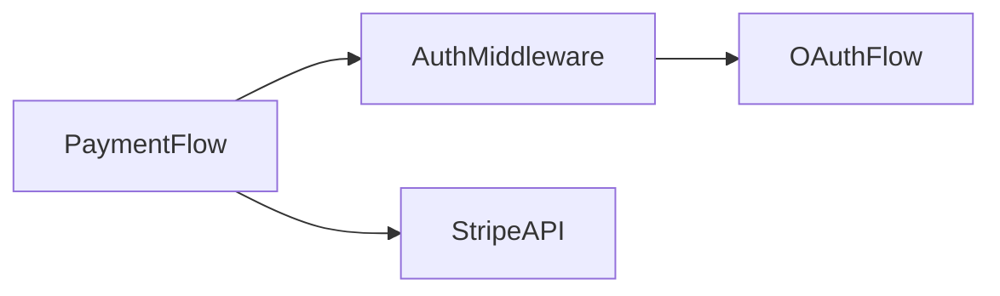

# Engineering Notes

Personal knowledge-capture system for engineering work. Creates structured, interconnected notes in a **gitignored** folder so knowledge persists across sessions, projects, and team changes — without leaking to git.

## When to use

- After exploring an unfamiliar codebase (you just learned how something works — capture it before you forget)
- After implementing a feature (document what you built, why, and how it connects)
- After researching a topic, library, API, or pattern
- After important conversations with team members or clients (decisions made, context shared)
- When the user says "document this", "write notes", "capture this", "eng-notes", "save what we found"
- When the user wants to review, search, or update existing notes

## Always listen — proactive capture, don't wait to be asked

This is not a skill you only invoke on request. Once a project has `.eng-notes/`,
continuously watch the conversation for two kinds of signal, in **any** message,
not just ones that name this skill:

1. **Finding language** — the user reports something they discovered, even in
   passing: *"I found that X uses API Y"*, *"turns out..."*, *"the root cause
   is/was..."*, *"[this UI/component/field] uses/calls/hits [an API/endpoint/
   table]"*, *"we decided to..."* / *"the decision was..."*, *"gotcha"* /
   *"non-obvious"*.
2. **Explicit capture commands** — a direct instruction to save something,
   regardless of phrasing: *"note this..."*, *"add this..."*, *"save this..."*,
   *"capture this..."*, *"log this..."*, *"remember this..."*, *"FYI: ..."*,
   *"Note: ..."*, *"Finding: ..."*, *"add this to the notes/knowledge base"*.

When either fires:
1. Check `INDEX.md` (and the graph, if set up — see below) for a related
   existing note first, so you don't create a duplicate.
2. Draft the new note, or the specific update to an existing note, following
   the template and writing rules below.
3. Show a **short summary** of what you'd write (not the full file dump) and
   ask for confirmation.
4. Only after the user confirms: write the file, update `INDEX.md`, and
   regenerate the graph (see "Keeping the graph up to date" below) — every
   time, no exceptions.

Never write a note without explicit confirmation, even though you should
always propose it proactively. If a message merely resembles this pattern but
isn't actually worth a note (small talk, an unrelated "note" in prose), say so
briefly and skip the flow rather than forcing a note into existence.

On hosts that support it (e.g. Pi), this proactive behavior can additionally be
enforced deterministically by a small extension that pattern-matches every
message in code (see `.pi/extensions/eng-notes-listener.ts` in a project that
has one) — that's a reinforcement of this rule, not a replacement for it. Apply
this behavior yourself regardless of host or whether such an extension exists.

## Setup

On first use in any project, initialize the notes folder:

```bash
NOTES_DIR=".eng-notes"
mkdir -p "$NOTES_DIR"/{features,research,codebase,conversations,architecture}

# Ensure gitignored (never push personal notes)
if [ -f .gitignore ]; then
  grep -qxF "$NOTES_DIR/" .gitignore || echo "$NOTES_DIR/" >> .gitignore
else
  echo "$NOTES_DIR/" > .gitignore
fi
```

The folder structure:

```
.eng-notes/
├── INDEX.md              ← auto-maintained master index
├── features/             ← feature deep-dives
├── research/             ← research findings & comparisons
├── codebase/             ← codebase exploration & architecture maps
├── conversations/        ← meeting/discussion summaries
└── architecture/         ← system design & data flow
```

## Note types

Determine the type from context, or ask the user if ambiguous:

| Type | When | Folder |
|------|------|--------|
| **feature** | After building/modifying a feature | `features/` |
| **research** | After investigating a topic, library, or pattern | `research/` |
| **codebase** | After exploring unfamiliar code | `codebase/` |
| **conversation** | After team/client discussions with useful context | `conversations/` |
| **architecture** | System design, data flow, how pieces fit together | `architecture/` |

## Writing a note

### File naming

Use lowercase kebab-case with a date prefix:
```
2025-01-15-payment-flow.md
2025-01-15-auth-middleware-exploration.md
2025-01-16-design-tokens-research.md
```

### Note structure

Every note follows this template. Read the matching template from `templates/` for the full structure:

- [templates/feature.md](templates/feature.md)
- [templates/research.md](templates/research.md)
- [templates/codebase.md](templates/codebase.md)
- [templates/conversation.md](templates/conversation.md)
- [templates/architecture.md](templates/architecture.md)

**Frontmatter fields** (every note):

| Field | Purpose | Example |
|-------|---------|--------|
| `title` | Short descriptive title | `"Payment Flow"` |
| `date` | When the note was created | `2025-01-15` |
| `type` | One of: feature, research, codebase, conversation, architecture | `feature` |
| `status` | draft, complete, or outdated | `complete` |
| `tags` | Keywords for search and INDEX grouping | `[payments, stripe]` |
| `related` | Links to other eng-notes files | `[codebase/2025-01-14-auth.md]` |
| `references` | External links: PRs, tickets, docs, Slack, Figma | see below |
| `project` | Project name | `"MavOS"` |
| `author` | Who wrote this note | `"Ahmed"` |

**`references` field shape**:

```yaml
references:
  prs:
    - url: https://github.com/org/repo/pull/123
      title: "Add payment retry logic"
  tickets:
    - url: https://jira.example.com/browse/MV-1234
      id: MV-1234
      title: "Implement staggered tire models"
  docs:
    - url: https://confluence.example.com/pages/123
      title: "Payment API spec v2"
  other:
    - url: https://figma.com/file/abc
      title: "Payment flow mockups"
    - url: https://slack.com/archives/C123/p456
      title: "Thread: Stripe webhook timeout decision"
```

### Writing rules

1. **Plain English**: Write like explaining to a smart colleague who're new to the project. No unexplained jargon.
2. **The "why" matters more than the "what"**: Anyone can read code. Capture WHY it's built this way, what alternatives were considered, what constraints exist.
3. **Be specific**: File paths, function names, line numbers, config keys — concrete references beat vague descriptions.
4. **Relationships are first-class**: Every note must have `related` in frontmatter pointing to other notes. When you create a note, check INDEX.md for related existing notes and update their `related` too.
5. **Diagrams when they help**: Use Mermaid for flow, architecture, sequence, or relationship diagrams. Don't force one if a list is clearer.
6. **Status matters**: Mark notes as `draft`, `complete`, or `outdated`. Update status when revisiting.
7. **Capture the human context**: Who told you this? When? Was it a decision or just how things happen to be? This context is gold when you return months later.
8. **Link external references**: Always include PRs, Jira tickets, Confluence pages, Figma links, Slack threads, or any external reference in the `references` frontmatter field and the References section. These are the breadcrumbs back to the source of truth.

### Mermaid diagram guidelines

Use diagrams when they clarify relationships that prose cannot:

- **Flowchart**: Data flow, request lifecycle, decision trees
- **Sequence**: API calls, event chains, user interactions
- **Class/ER**: Data models, entity relationships
- **Graph**: Concept relationships, dependency maps

Keep diagrams focused — one idea per diagram. Label everything.

## Updating INDEX.md

After creating or significantly updating a note, update `INDEX.md`:

```markdown
# Engineering Notes Index

> Last updated: 2025-01-15
> Total notes: 12
> Project: [project name]

## Recent Notes

| Date | Title | Type | Tickets | Tags |
|------|-------|------|---------|------|
| 2025-01-15 | [Payment Flow](features/2025-01-15-payment-flow.md) | feature | MV-1234 | payments, stripe |
| 2025-01-14 | [Auth Middleware](codebase/2025-01-14-auth-middleware.md) | codebase | — | auth, security |

## By Tag

- **auth**: [Auth Middleware](codebase/2025-01-14-auth-middleware.md), [OAuth Flow](research/2025-01-10-oauth-flow.md)
- **payments**: [Payment Flow](features/2025-01-15-payment-flow.md)

## Relationship Map


```

## Keeping the graph up to date (graphify integration)

`.eng-notes/` is designed to also be browsed as a real, explorable knowledge
graph via [graphify](https://github.com/safishamsi/graphify) — community
detection, honest relationship inference (`EXTRACTED`/`INFERRED`/`AMBIGUOUS`),
and an Obsidian vault export with a Canvas board for freeform brainstorming.
This is a stronger, more connected view than `INDEX.md` tables alone can give.

**One-time setup per project** (check first — don't redo it if it already exists):

1. Confirm `graphify` is installed: `which graphify`. If missing, see the
   `graphify` skill for install steps.
2. Create `.eng-notes/.graphifyignore` so the graph reflects only real
   knowledge, not tooling:
   ```
   scripts/
   *.html
   graph-data.js
   graphify-out/
   ```
3. Pick a backend graphify can use for semantic extraction, in this order of
   preference: (a) a local Ollama model if `ollama list` shows one installed
   (fully free, fully local — e.g. `--backend ollama --model gemma3:12b`), (b)
   whichever hosted backend already has an API key set in the environment
   (`gemini`/`kimi`/`claude`/`openai`/`deepseek`), (c) if neither, do the
   semantic extraction inline yourself as the graphify skill describes for
   hosts that can't dispatch subagents — never block on asking the user for
   an API key.
4. Save the three-command recipe as `.eng-notes/scripts/regen-graph.sh` so
   regeneration is always one command:
   ```bash
   cd .eng-notes
   graphify extract . --backend <chosen-backend> --model <model> --no-gitignore
   graphify cluster-only . --backend <chosen-backend> --model <model>
   graphify export obsidian
   ```

**After every single note create or update — no exceptions:** run
`.eng-notes/scripts/regen-graph.sh` (or the three commands above if the
project hasn't been set up yet — offer to set it up rather than skipping the
graph). The graph must never be allowed to drift out of sync with what's
actually on disk. Treat this the same as updating `INDEX.md` — both happen
every time, not "eventually" or "when it seems worth it".

If a project can't run graphify (no Python/uv available, sandboxed
environment, etc.), say so explicitly and fall back to keeping `INDEX.md`
as the only index — don't silently skip the regeneration step without
mentioning it.

## Workflow

### Creating a note

1. Determine note type from context
2. Check INDEX.md for related existing notes
3. Create the note file with proper frontmatter
4. Write the content following the template and writing rules
5. Add Mermaid diagrams where they clarify
6. Update INDEX.md (add entry, update tags, update relationship map)
7. Update `related` fields in any linked existing notes
8. **Regenerate the graphify graph** (`.eng-notes/scripts/regen-graph.sh`, or
   offer to set it up if this project doesn't have it yet) — every time, not
   just for "big" notes

### Reviewing notes

When the user asks to review or search notes:
1. Read INDEX.md for the overview
2. Search by tag, date, or keyword in note content
3. Present relevant notes with context
4. Offer to update outdated notes

### Updating notes

When revisiting a topic:
1. Find the existing note
2. Update the content, add new findings
3. Change status if needed
4. Update the date in frontmatter
5. Update INDEX.md if relationships changed
6. **Regenerate the graphify graph** (same command as above) — an update is
   just as likely to change relationships as a new note is; never skip this
   step because "it's just an edit"

## Conversation capture specifics

When documenting a conversation or meeting:

1. **Who was there**: Names and roles
2. **What was decided**: Clear decisions with rationale
3. **What was discussed**: Key topics, not a transcript
4. **Action items**: Who does what by when
5. **Context shared**: The "why" behind existing decisions — this is often the most valuable part
6. **Open questions**: Things still unresolved

Focus on capturing **tribal knowledge** — the stuff that's in people's heads but not in docs. That's the gold.

## Codebase exploration specifics

When documenting exploration of unfamiliar code:

1. **Start from the entry point**: Where does the request/data flow begin?
2. **Trace the path**: Follow the code step by step, document each stop
3. **Map the key files**: Which files matter most and why
4. **Document the "gotchas"**: Non-obvious behavior, hidden dependencies, things that surprised you
5. **Note what's confusing**: If you were confused, the next person will be too
6. **Draw the flow**: A Mermaid sequence or flowchart showing the main path

## Populating references

When creating a note, try to link it to existing work artifacts. The order of preference:

1. **Jira tickets**: If the work came from a ticket, always link it. Use the MCP Atlassian tools or the `jira-integration` skill to fetch ticket details (summary, description, acceptance criteria) and include the ticket ID + URL. If the user mentions a ticket number, look it up and pull context.
2. **PRs**: If code was written, link the PR(s). Use GitHub MCP tools or `gh pr list` to find relevant PRs. Include what the PR changed in one line.
3. **Confluence/docs**: If there's a spec, design doc, or API doc, link it.
4. **Slack/Teams threads**: If a decision was made in a thread, link it (even if it's just a URL paste — future you will thank present you).
5. **Figma/design**: If there are mockups, link them.

When the user mentions a ticket or PR during a conversation, proactively fetch its details and include them in the note — don't wait to be asked.

## Cross-project notes

Some knowledge spans projects (patterns, preferences, reusable solutions). For these:
- Tag with `cross-project` in frontmatter
- Keep in the most relevant project's `.eng-notes/`
- Reference in other projects' INDEX.md as external references
