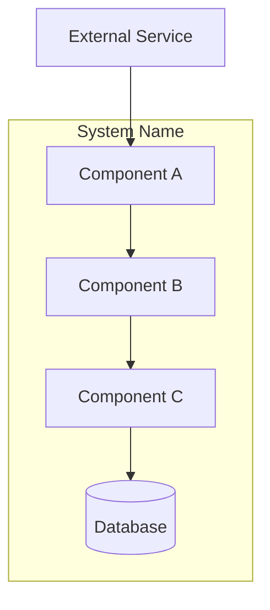
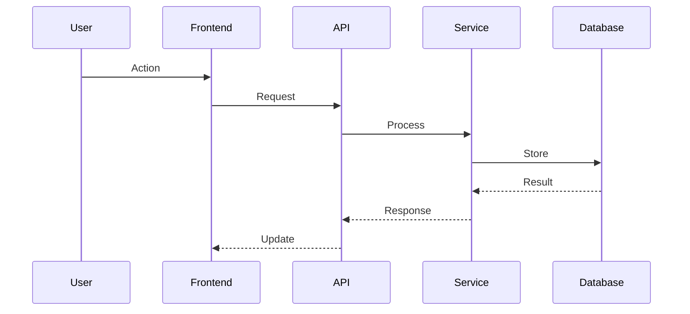

# System/Area Name

## What This Is

One-paragraph description of the system or architectural area.

> Example: "The notification system handles all outbound communications — email, SMS, and push. It's event-driven: services publish events to a queue, and the notification service consumes them, resolves templates, and dispatches through the appropriate channel."

## High-Level Architecture

## Components

### Component 1: [Name]

- **Purpose**: What it does
- **Tech**: What it's built with
- **Key files**: Where to find it
- **Responsibilities**: What it owns

### Component 2: [Name]

...

## Data Flow

How data moves through the system end-to-end:

## Key Patterns

Architectural patterns used and why:

| Pattern | Where | Why |
|---------|-------|-----|
| [Pattern] | [Where used] | [Why chosen over alternatives] |

## Constraints & Trade-offs

Known constraints and the trade-offs made:

- **Constraint**: [What limits exist]
  - Trade-off: [What was sacrificed]
  - Reason: [Why it was acceptable]

## Scaling & Performance

How does this system handle load? What are the bottlenecks?

## Failure Modes

What happens when things break?

| Failure | Impact | Recovery |
|---------|--------|----------|
| [Component fails] | [What breaks] | [How it recovers] |

## Related Systems

How does this connect to other parts of the product?

- **Upstream**: What feeds into this system
- **Downstream**: What this system feeds

## References

### PRs
- [PR title](URL) — what it changed

### Tickets
- [TICKET-ID](URL) — ticket title / description

### Documentation
- [Doc title](URL) — what it covers

### Other
- [Figma / Slack / Confluence](URL) — context

## Open Questions

- [ ] Known architectural concerns
- [ ] Areas needing redesign
- [ ] Scaling concerns for the future
