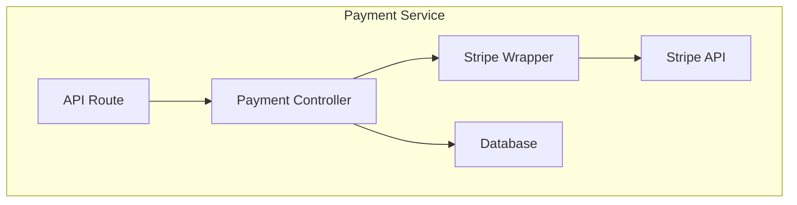

# Codebase/Area Name

## Why I Explored This

What prompted you to explore this code? New to the project? Debugging something? Onboarding?

## Overview

What is this codebase/area? What's its purpose in one paragraph?

> Example: "The `src/services/payment/` directory handles all payment processing. It wraps the Stripe API, manages payment intents, and handles webhooks. It's the single source of truth for payment state."

## Key Files

| File | Purpose | Why It Matters |
|------|---------|----------------|
| `src/services/payment/index.ts` | Entry point | Exports the public API |
| `src/services/payment/stripe.ts` | Stripe wrapper | All Stripe API calls go through here |
| `src/services/payment/webhooks.ts` | Webhook handler | Processes Stripe events |

## How It Fits Together

### Entry Points

Where do requests/data enter this area?

### Main Flow

Step-by-step walkthrough of the primary path:

1. Request arrives at [entry point]
2. [Function A] does [what]
3. Data flows to [Function B]
4. Result is [returned/stored/sent]

### Data Models

What are the key data structures?

```
PaymentIntent {
  id: string
  amount: number
  status: 'pending' | 'completed' | 'failed'
  ...
}
```

## Diagram



## Dependencies

- **External**: Libraries, APIs, services this code talks to
- **Internal**: Other parts of the codebase this depends on
- **Depends on this**: What breaks if this changes?

## Gotchas

Non-obvious things you discovered:

- ⚠️ [Something that surprised you]
- ⚠️ [Hidden dependency]
- ⚠️ [Non-obvious behavior]

## What's Confusing

Parts that were hard to understand — the next person exploring will hit the same walls:

- 🤔 [Confusing part and why]

## References

### PRs
- [PR title](URL) — what it changed

### Tickets
- [TICKET-ID](URL) — ticket title / description

### Documentation
- [Doc title](URL) — what it covers

### Other
- [Figma / Slack / Confluence](URL) — context

## Open Questions

- [ ] Parts you didn't fully understand
- [ ] Areas that need refactoring
- [ ] Things to investigate further
