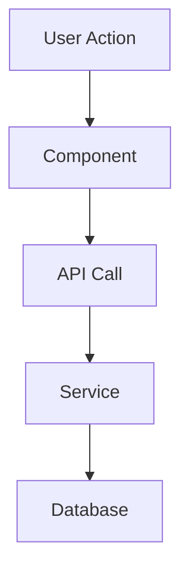

# Feature Name

## Context

Why does this feature exist? What problem does it solve? Who requested it and why?

> Example: "The client needed users to be able to save payment methods for faster checkout. This was a top-3 support request — users were re-entering cards every purchase."

## What This Feature Does

Plain English description of what the feature does from the user's perspective.

## How It Works

Technical explanation of the implementation. Include:

- **Key files**: Which files contain the core logic
- **Entry point**: Where the flow starts (route, handler, component)
- **Data flow**: How data moves through the system
- **Key functions/classes**: The important pieces and what each does

## Decisions Made

What design/implementation decisions were made and WHY:

| Decision | Why | Alternatives Considered |
|----------|-----|------------------------|
| Used X library | Y reason | Considered Z because of W |

## Dependencies & Connections

What does this feature depend on? What depends on it?

- **Depends on**: APIs, services, libraries, other features
- **Blocks/affects**: Other features, teams, workflows

## Diagram

## Gotchas & Edge Cases

Things that surprised you, non-obvious behavior, or things to watch out for:

- ⚠️ [Gotcha description]
- ⚠️ [Another gotcha]

## Testing

How is this tested? What's the test coverage like? What's hard to test?

## References

### PRs
- [PR title](URL) — what it changed

### Tickets
- [TICKET-ID](URL) — ticket title / description

### Documentation
- [Doc title](URL) — what it covers

### Other
- [Figma / Slack / Confluence](URL) — context

## Open Questions

- [ ] Anything still unclear or unresolved?
- [ ] Known limitations or future improvements?
